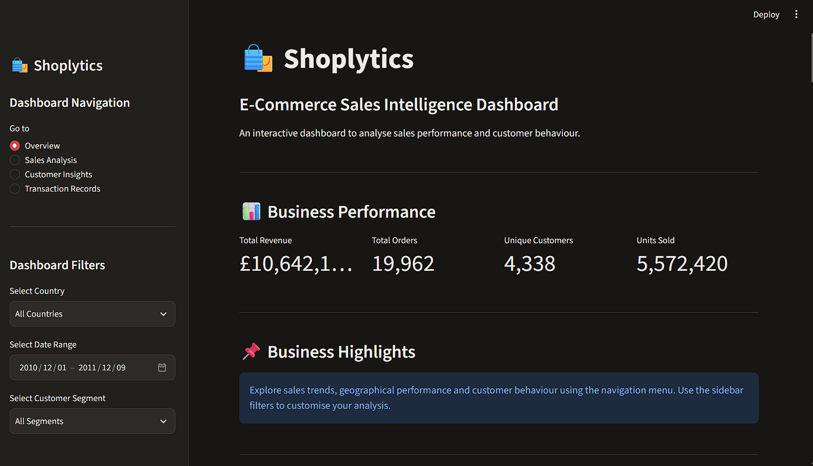
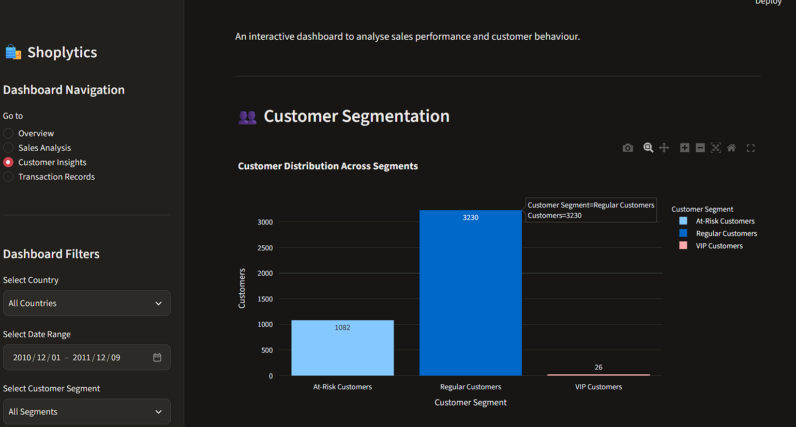
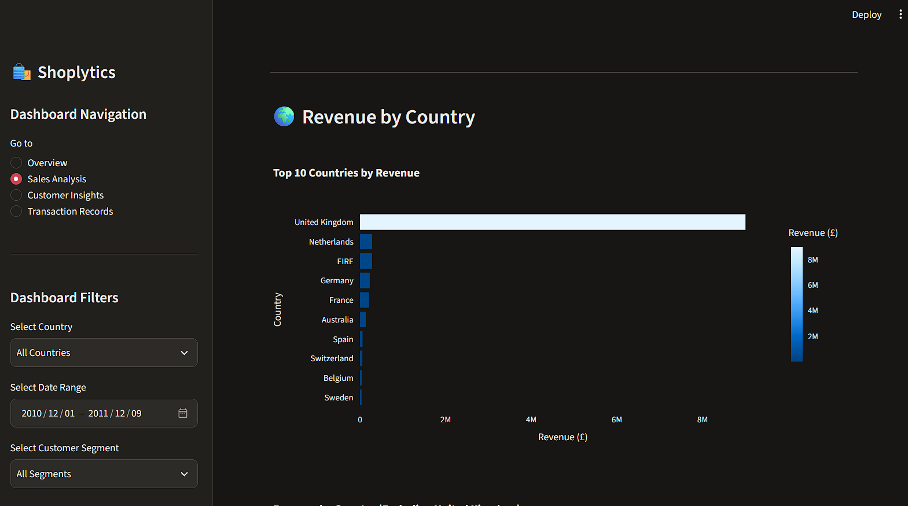
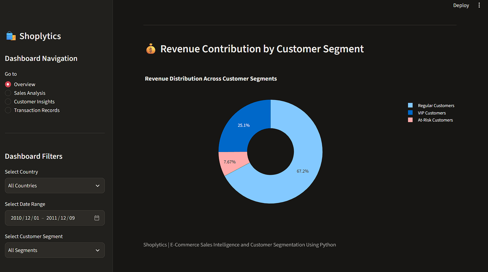

#  Shoplytics
### E-Commerce Sales Intelligence & Customer Segmentation Using Python

##  Project Overview
Shoplytics is a data analytics project that analyses e-commerce transaction data to uncover sales trends, product performance and customer purchasing behaviour.

The project uses Python for data cleaning, exploratory data analysis, RFM analysis and K-Means customer segmentation. An interactive dashboard is developed using Streamlit and Plotly.

## Project Objectives
- Analyse overall sales and revenue performance.
- Identify top-performing products and countries.
- Understand customer purchasing patterns.
- Segment customers using RFM analysis and K-Means clustering.
- Present business insights through an interactive dashboard.

##  Technologies Used
- Python
- Pandas
- NumPy
- Matplotlib
- Seaborn
- Scikit-learn
- Streamlit
- Plotly
- Jupyter Notebook

##  Key Features

### 1. Data Cleaning and EDA
- Missing value and duplicate analysis.
- Data type conversion.
- Handling cancelled transactions and invalid sales records.
- Revenue calculation and exploratory analysis.

### 2. Sales Analysis
- Monthly revenue trends.
- Country-wise revenue analysis.
- Top 10 products by revenue.
- Key sales performance metrics.

### 3. Customer Segmentation
- Recency, Frequency and Monetary (RFM) analysis.
- Feature scaling using StandardScaler.
- Customer segmentation using K-Means clustering.
- Identification of VIP, Regular and At-Risk customers.

### 4. Interactive Dashboard
- KPI cards.
- Interactive sidebar filters.
- Customer insights and segmentation.
- Repeat vs one-time customer analysis.
- Revenue contribution by customer segment.
- Transaction data download.

##  Project Structure

```text
Shoplytics/
├── data/
│   ├── online_retail.csv
│   ├── shoplytics_dashboard.csv
│   └── app.py
├── notebooks/
│   └── data_exploration.ipynb
├── src/
│   ├── data_exploration.py
│   └── test_libraries.py
├── README.md
└── requirements.txt
```

##  Installation and Setup

1. Clone the repository:

```POWERSHELL
git clone YOUR_GITHUB_REPOSITORY_URL
```

2. Navigate to the project folder:

```POWERSHELL
cd Shoplytics
```

3. Install dependencies:

```POWERSHELL
python -m pip install -r requirements.txt
```

4. Run the Streamlit dashboard:

```POWERSHELL
python -m streamlit run data/app.py
```

##  Business Insights
Shoplytics helps businesses understand revenue performance, identify valuable customers, recognise inactive customer segments and make data-driven decisions.


## 📸 Dashboard Screenshots







##  Author
Revathi Narayanan
